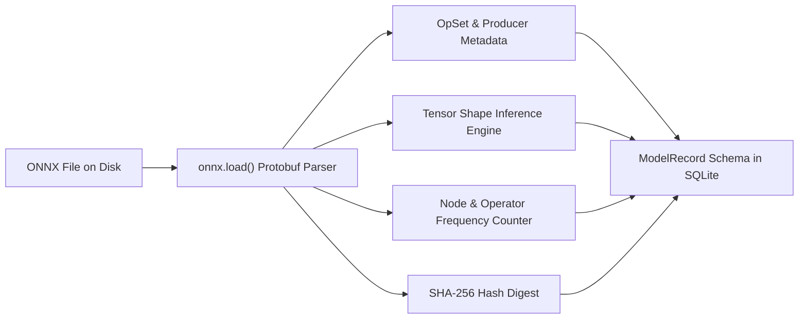
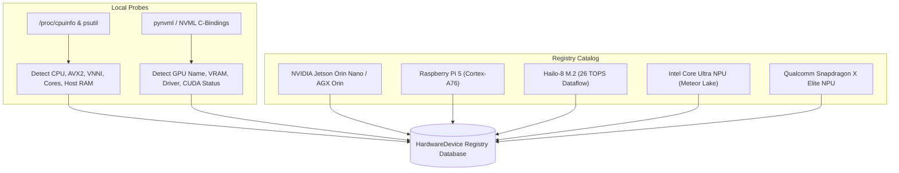
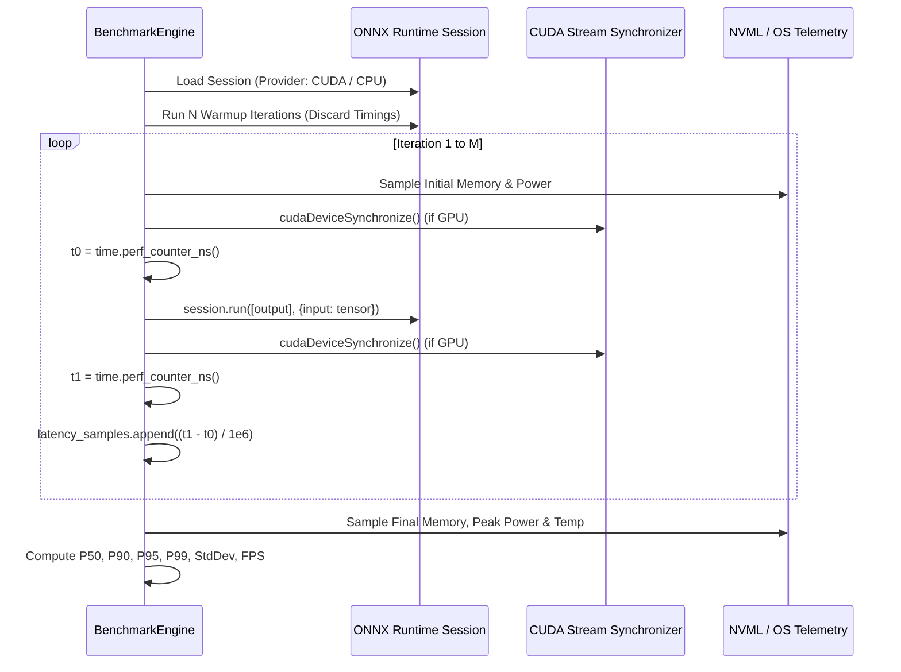
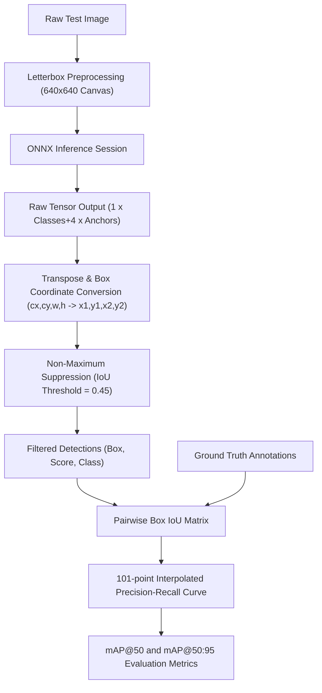
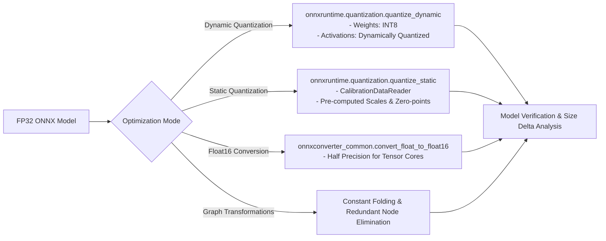
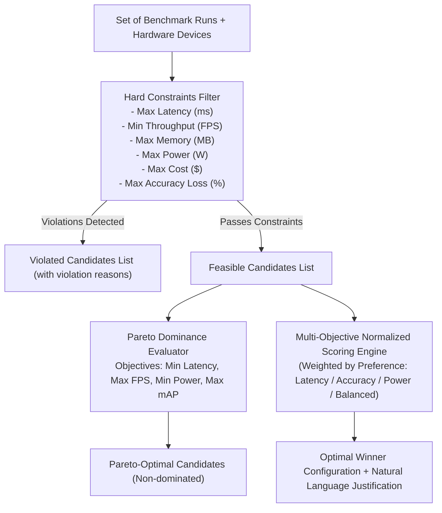
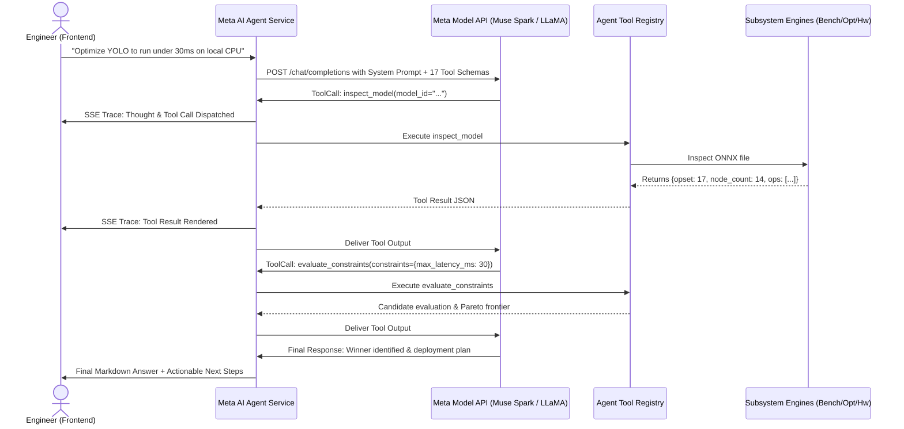

# EdgeForge Architecture & Technical Deep Dive

> **Technical Architecture Specification**  
> System Design, Engine Subsystems, Telemetry Instrumentation, Optimization Pipelines, and Meta AI Integration.

---

## 1. System Overview & Modular Monolith Design

EdgeForge is architected as a high-throughput, vendor-neutral edge deployment intelligence platform. To ensure zero operational friction, reproducible local testing, and rapid deployment on both workstations and edge servers, EdgeForge follows a **Modular Monolith** architecture:

```
                                  +---------------------------------------+
                                  |         Next.js 16 Web Client         |
                                  |  - Responsive Radar & Pareto Charts   |
                                  |  - Real-time Benchmark Stream (SSE)   |
                                  |  - Meta AI Agent Interactive Timeline |
                                  +---------------------------------------+
                                                     |
                                                     | HTTP / REST / SSE
                                                     v
+-------------------------------------------------------------------------------------------------------------+
|                                        FastAPI Application Server                                           |
+-------------------------------------------------------------------------------------------------------------+
|                                                                                                             |
|  [REST Endpoints]                                                                                           |
|  /api/v1/models        /api/v1/hardware        /api/v1/experiments      /api/v1/agent      /api/v1/deploy  |
|         |                     |                         |                      |                 |          |
+---------|---------------------|-------------------------|----------------------|-----------------|----------+
|         v                     v                         v                      v                 v          |
|  +--------------+    +-----------------+    +----------------------+    +--------------+  +---------------+ |
|  |     ONNX     |    | Hardware Probe  |    |  Benchmark Engine &  |    |   Meta AI    |  |  Deployment   | |
|  |  Inspection  |    |  & Silicon Hub  |    | Telemetry Collector  |    | Agent Engine |  |    Bundler    | |
|  |  Subsystem   |    | (NVML + CPU)    |    | (CUDA Sync + Timer)  |    | (17 Tools)   |  | (ZIP & Verify)| |
|  +--------------+    +-----------------+    +----------------------+    +--------------+  +---------------+ |
|         |                     |                         |                      |                 |          |
|         +---------------------+-------------------------+----------------------+-----------------+          |
|                                                     |                                                       |
|                                                     v                                                       |
|                                  +-------------------------------------+                                    |
|                                  |   Optimization & Pareto Engines     |                                    |
|                                  | - INT8 Dynamic / Static Calibration |                                    |
|                                  | - FP16 Float16 Cast Engine          |                                    |
|                                  | - Pareto Non-Dominated Sorting      |                                    |
|                                  | - 101-point mAP@50:95 Evaluator     |                                    |
|                                  +-------------------------------------+                                    |
|                                                     |                                                       |
|                                                     v                                                       |
|                                  +-------------------------------------+                                    |
|                                  |   Async SQLAlchemy + SQLite Engine  |                                    |
|                                  |       (storage/edgeforge.db)        |                                    |
|                                  +-------------------------------------+                                    |
+-------------------------------------------------------------------------------------------------------------+
```

### Core Design Principles:
1. **Vendor Neutrality**: Abstraction layers avoid coupling with vendor-proprietary APIs. Runtime sessions execute through ONNX Runtime Execution Providers (`CPUExecutionProvider`, `CUDAExecutionProvider`, `TensorrtExecutionProvider`, `OpenVINOExecutionProvider`).
2. **Empirical Ground Truth**: Synthetic specs are separated from measured reality. Local devices run real inference loops with high-resolution hardware timers and memory telemetry.
3. **Reproducibility Guarantee**: Every benchmark run records full provenance: kernel version, OS release, CPU flags, execution provider versions, model SHA-256 hash, and batch parameters.
4. **Deterministic Resilience**: The system operates with full autonomy when connected to Meta AI endpoints, while offering a complete deterministic fallback agent for offline or air-gapped environments.

---

## 2. Model & Graph Inspection Subsystem

The ONNX inspection subsystem parses computational graphs without executing tensors, extracting topological metadata and validating operator sets.



### Key Technical Characteristics:
- **Graph Traversal**: Inspects all `model.graph.node` entities to construct an operator frequency histogram (e.g., `Conv: 5, Sigmoid: 4, Mul: 4, Reshape: 1`).
- **Dynamic Dimension Resolution**: Safely handles symbolic dimensions (e.g., `batch`, `height`, `width`) and maps tensor data types (`float32`, `float16`, `int8`, `uint8`).
- **Cryptographic Provenance**: Computes SHA-256 digest of the model bytes to detect unauthorized modifications or model corruption.
- **Fail-Fast Validation**: Flags unsupported or experimental opsets before scheduling runs on edge silicon.

---

## 3. Hardware Detection Subsystem

The hardware subsystem discovers physical silicon available on the local host and correlates it with a curated **Edge Hardware Registry** of embedded silicon.



### Probe Mechanisms:
1. **CPU & Host Memory**:
   - Parses flags in `/proc/cpuinfo` to detect Vector Neural Network Instructions (`VNNI`), `AVX2`, and `AVX512`.
   - Queries `psutil.virtual_memory()` for available physical memory and `psutil.cpu_count(logical=True/False)`.
2. **NVIDIA GPU & NVML**:
   - Calls `pynvml.nvmlInit()`.
   - Enumerates devices, extracting VRAM size, compute capability, active driver version, and live power states.
3. **Simulated Silicon Targets**:
   - Maintains formal profiles for prominent edge devices (Jetson Orin Nano, Raspberry Pi 5, Hailo-8 M.2, Qualcomm Snapdragon X Elite, Intel Meteor Lake NPU), including typical TDP (W), peak TOPS, architectural traits, and market BOM costs.

---

## 4. Benchmarking Engine & Telemetry Instrumentation

Accurate edge benchmarking requires bypassing CPU throttling artifacts, memory warmup delays, and asynchronous GPU stream queuing.



### Telemetry Implementation:
- **Nanosecond Precision**: Timing relies on Python's `time.perf_counter_ns()` to minimize timer API invocation overhead.
- **Warmup Phase**: Configurable warmup runs (typically 3–10) ensure CPU instruction caches and GPU kernel launch pipelines are warm before samples are recorded.
- **CUDA Stream Synchronization**: When running via `CUDAExecutionProvider` or `TensorrtExecutionProvider`, `torch.cuda.synchronize()` or ctypes CUDA stream barriers are invoked so the host clock measures complete device execution rather than asynchronous queue dispatch.
- **RSS & VRAM Tracking**: Tracks host Resident Set Size (RSS) delta via `psutil.Process().memory_info().rss` and GPU allocated memory via `nvmlDeviceGetMemoryInfo()`.
- **Thermal & Power Monitoring**: On supported hardware, samples milliwatt power draw and temperature via NVML to identify thermal throttling risks.

---

## 5. Computer Vision Evaluation Engine

Benchmarking edge models without validating accuracy risks deploying degenerate or broken models. EdgeForge incorporates a native evaluation engine for object detection models:



### Algorithmic Highlights:
- **Pairwise Intersection over Union (IoU)**:
  $$\text{IoU} = \frac{\text{Area of Overlap}}{\text{Area of Union}} = \frac{(x_2 - x_1) \times (y_2 - y_1)}{\text{Area}_A + \text{Area}_B - \text{Area}_{\text{Overlap}}}$$
- **101-Point Interpolated Average Precision (COCO standard)**:
  Interpolates maximum precision across 101 recall thresholds from $0.0$ to $1.0$ with step size $0.01$:
  $$\text{AP} = \frac{1}{101} \sum_{r \in \{0.0, 0.01, \dots, 1.0\}} \max_{\tilde{r} \ge r} p(\tilde{r})$$
- **Multi-Threshold mAP@50:95**: Computes average AP over 10 IoU thresholds from $0.50$ to $0.95$ in $0.05$ increments.

---

## 6. Optimization Engine

The optimization subsystem compresses and transforms models to run on resource-constrained targets:



### Quantization Modes:
1. **Dynamic INT8**:
   - Quantizes weight matrices to 8-bit signed integers (`int8`).
   - Dynamically evaluates activation scale factors at runtime.
   - Ideal for bandwidth-constrained CPUs with negligible memory overhead.
2. **Static INT8 with Calibration**:
   - Feeds representative validation datasets through `CalibrationDataReader`.
   - Fixes static quantization scales for activations and weights, avoiding runtime overhead on NPUs and DSPs.
3. **FP16 Half-Precision**:
   - Converts standard FP32 weights to IEEE 754 half-precision float16.
   - Halves memory footprint and unlocks NVIDIA Tensor Core and ARM FP16 arithmetic throughput.

---

## 7. Multi-Objective Recommendation & Pareto Frontier Engine

Rather than relying on arbitrary linear weights, EdgeForge applies **Pareto dominance analysis** across competing operational dimensions:

$$\text{Candidate } A \text{ dominates } B \iff \forall i \, (A_i \text{ is as good as } B_i) \land \exists j \, (A_j \text{ is strictly better than } B_j)$$



### Scoring and Objective Normalization:
- **Normalized Components (0–100 scale)**:
  - Latency score: $\max(0, 100 - \min(100, \text{latency}_{\text{ms}}))$
  - FPS score: $\min(100, \text{FPS} \times 1.5)$
  - Power score: $\max(0, 100 - \text{TDP}_{\text{watts}})$
  - Accuracy score: $\text{mAP@50} \times 100$
  - Cost score: $\max(0, 100 - (\text{cost}_{\text{usd}} / 20))$
- **Dynamic Weight Profiles**: Adjusts weights dynamically based on user intent (`latency`, `accuracy`, `power`, or `balanced`).

---

## 8. Meta AI Deployment Engineer & Tool Orchestration

The autonomous deployment engineer connects to Meta's generative models using the official Meta Model API schema, wrapping 17 strongly typed tools into an observable reasoning loop:



### Tool Ecosystem (17 Typed Tools):
1. `inspect_model`: Validates ONNX file integrity, opset, inputs, outputs, and SHA-256.
2. `inspect_onnx_graph`: Deep topological graph traversal and tensor dimension check.
3. `inspect_dataset`: Evaluates validation images and annotation bounding boxes.
4. `list_hardware`: Lists all online, offline, and simulated silicon devices.
5. `check_runtime_capabilities`: Verifies execution providers and precisions for a target device.
6. `check_model_compatibility`: Confirms operator support on selected runtime silicon.
7. `list_existing_benchmarks`: Retrieves historical telemetry for a model.
8. `create_experiment`: Configures a benchmark job with parameters.
9. `run_benchmark`: Executes the benchmark with warmup and timing.
10. `get_experiment_status`: Monitors real-time progress and logs.
11. `inspect_compiler_errors`: Diagnoses runtime provider compilation or kernel errors.
12. `analyze_quantization`: Executes INT8/FP16 compression and computes compression ratio.
13. `compare_runs`: Generates side-by-side metric comparison across configurations.
14. `evaluate_constraints`: Eliminates candidates violating user-defined operational constraints.
15. `recommend_hardware`: Identifies Pareto frontier and selects the optimal winner.
16. `generate_report`: Formats structured deployment summary with audit trace.
17. `export_deployment_package`: Bundles self-contained ZIP package for edge distribution.

---

## 9. Deployment Bundler & Verification Subsystem

The deployment bundler guarantees that configurations validated in the UI can be transferred to remote edge devices without hidden dependencies:

```
+-------------------------------------------------------------------+
|               edgeforge_bundle_<uuid>.zip                         |
+-------------------------------------------------------------------+
|  ├── model.onnx           # Verified FP32 or INT8 optimized graph |
|  ├── config.json          # Hardware targets, shapes & latency    |
|  ├── infer.py             # Standalone Python runner              |
|  ├── requirements.txt     # Locked, minimal edge dependencies     |
|  └── README.md            # Hardware-specific execution guide     |
+-------------------------------------------------------------------+
```

### In-System Smoke Verification:
When a bundle is generated, the backend runs an automated verification check:
1. Spawns an isolated Python subprocess executing `infer.py` with synthetic data.
2. Validates session initialization on target execution providers.
3. Confirms non-zero output tensors and latency within 10% of recorded benchmarks.
4. Records `verification_status: "PASSED"` in the database.
